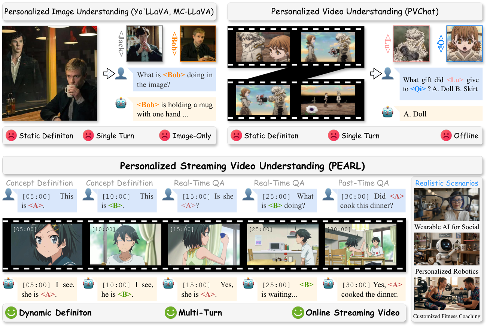
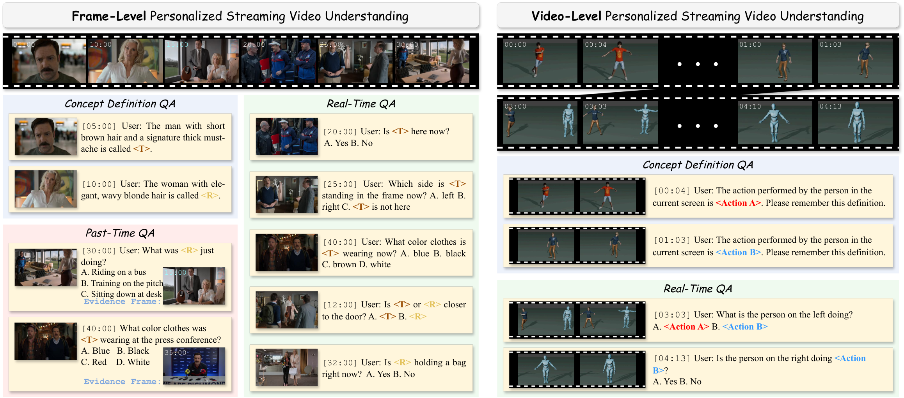
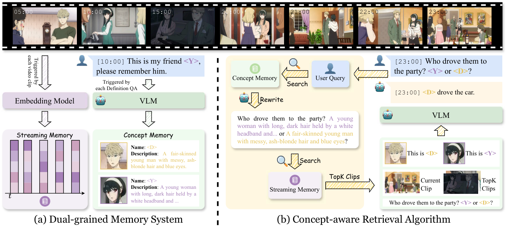

<p align="center">
  
</p>

<p align="center">
  <a href="https://arxiv.org/abs/2603.20422" style="margin-right: 10px;">
    
  </a>
  <a href="https://huggingface.co/datasets/zyh200727/PSVU-Bench" style="margin-right: 10px;">
    
  </a>
  <a href="https://huggingface.co/datasets/zyh200727/PSVU-10K" style="margin-right: 10px;">
    
  </a>
  <a href="https://huggingface.co/zyh200727/PEARL-Qwen3-VL-8B-LoRA" style="margin-right: 10px;">
    
  </a>
  <a href="https://www.modelscope.cn/datasets/YuanhongZheng/PEARL-Data" style="margin-right: 10px;">
    
  </a>
</p>

<h1 align="center">PEARL: Personalized Streaming Video Understanding with Runtime-Defined Concepts</h1>

<p align="center">
  <a href="https://github.com/Yuanhong-Zheng">Yuanhong Zheng</a><sup>1,*</sup>, <a href="https://github.com/arctanxarc">Ruichuan An</a><sup>1,*</sup>, <a href="">Xiaopeng Lin</a><sup>1</sup>, <a href="">Yuxing Liu</a><sup>1</sup>, <a href="">Sihan Yang</a><sup>1</sup>, <a href="">Huanyu Zhang</a><sup>3</sup>, <a href="">Haodong Li</a><sup>4</sup>, <a href="">Qintong Zhang</a><sup>1</sup>, <a href="">Renrui Zhang</a><sup>5</sup>, <a href="">Guopeng Li</a><sup>4</sup>, <a href="">Yifan Zhang</a><sup>3,&dagger;</sup>, <a href="">Yuheng Li</a><sup>2,&#9993;</sup>, <a href="">Wentao Zhang</a><sup>1,6,&#9993;</sup>
</p>

<p align="center">
  <sup>1</sup>Peking University &nbsp; <sup>2</sup>Adobe &nbsp; <sup>3</sup>CASIA &nbsp; <sup>4</sup>Stepfun &nbsp; <sup>5</sup>CUHK &nbsp; <sup>6</sup>Zhongguancun Academy
</p>

<p align="center">
  <sup>*</sup>Equal contribution &nbsp; <sup>&dagger;</sup>Project leader &nbsp; <sup>&#9993;</sup>Corresponding authors
</p>

> PEARL studies Personalized Streaming Video Understanding (PSVU), where a user defines new concepts in the middle of a video stream and later asks about their current state or their earlier appearances. We introduce PSVU-Bench, the first benchmark for this task, and PEARL, a strong plug-and-play baseline that stores user-defined concepts apart from archived video clips and rewrites each query with concept descriptions to retrieve the relevant history. We further build PSVU-10K, a training set of verified concept questions, and train the retriever and answering VLM of PEARL on it once. Concepts defined at test time still require no training.

<p align="center">
  
</p>
<p align="center">
  <em>Personalized Streaming Video Understanding: continuous video input, concepts defined at runtime, and multi-turn interaction.</em>
</p>

## 📰 News

- **[2026-11]** PEARL v1.0, accompanying the updated paper *PEARL: Personalized Streaming Video Understanding with Runtime-Defined Concepts*. The benchmark is renamed PSVU-Bench and now includes the Action split and per-question categories. This release adds the PSVU-10K training set, the training code, the trained LoRA adapters and per-category evaluation. See [CHANGELOG.md](CHANGELOG.md).
- **[2026-03]** Initial release (v0.1, tag `v0.1-arxiv-v1`) with the frame-level benchmark data and the PEARL inference code.

## 🔍 Overview

**Task.** In PSVU, a model watches a continuous video stream in which a user can define a new concept at any timestamp, e.g. "This is {Kacen}". At later timestamps the user asks about the concept. Answering requires binding the new name to what is on screen and recalling what the concept did since.

**PSVU-Bench.** 132 videos and 2,173 timestamped annotations from anime, movies, reality shows and digital humans. Concept-Definition QA registers concepts, Real-Time QA asks about their current state (Presence, Behavior, Appearance, Location, Relation and Action), and Past-Time QA asks about their earlier states or activities (Event-based and Time-based) and requires retrieving historical evidence. Entity concepts are defined by a reference frame (frame-level split, 112 videos), and action concepts by a reference clip (Action split).

<p align="center">
  
</p>
<p align="center">
  <em>PSVU-Bench examples: entity concepts defined by a frame (left) and action concepts defined by a clip (right).</em>
</p>

**PEARL.** A plug-and-play framework for off-the-shelf VLMs. Its Dual-grained Memory System keeps each registered concept, a reference frame or clip with a generated description, apart from a streaming memory that embeds every incoming video clip. The Concept-aware Retrieval Algorithm replaces each concept name in the query with its stored description and retrieves the most relevant historical clips. The VLM then answers from the concept references, the retrieved clips and the current clip.

<p align="center">
  
</p>
<p align="center">
  <em>PEARL: Dual-grained Memory System and Concept-aware Retrieval Algorithm.</em>
</p>

**PSVU-10K training.** Grounding a named concept in video is a skill shared by all concepts, so PEARL learns it once. PSVU-10K contains 10k four-option Real-Time and Past-Time questions on YouTube videos of 155 narrative works (9k for training and 1k for validation), each generated and verified by an open-source VLM through four verification gates. No PSVU-Bench work appears in PSVU-10K. With LoRA, we train the query path of the retriever (Qwen3-VL-Embedding-2B) while keeping the clip encoder frozen, so the streaming memory never needs to be rebuilt, and we fine-tune the answering VLM. The inference pipeline is unchanged.

## 🏆 Main Results

Results on PSVU-Bench. Each question is evaluated under four option rotations and counts as correct only if all four are answered correctly. Real-Time Avg and Past-Time Avg are the means of their categories, and Overall Avg is the mean of the two. † denotes training on PSVU-10K, and all other models are used without training. **Bold** and <u>underline</u> denote the best and second-best results among open-source models and PEARL.

<table>
  <thead>
    <tr><th rowspan="2">Method</th><th rowspan="2">#Frames</th><th rowspan="2">Token<br>Budget</th><th colspan="7">Real-Time QA</th><th colspan="3">Past-Time QA</th><th rowspan="2">Overall<br>Avg</th></tr>
    <tr><th>Presence</th><th>Behavior</th><th>Appearance</th><th>Location</th><th>Relation</th><th>Action</th><th>Avg</th><th>Event</th><th>Time</th><th>Avg</th></tr>
  </thead>
  <tbody>
    <tr><td colspan="14" align="center"><i>Human Score</i></td></tr>
    <tr><td align="left">Human</td><td align="center">-</td><td align="center">--</td><td align="center">94.21</td><td align="center">93.48</td><td align="center">94.02</td><td align="center">93.28</td><td align="center">94.50</td><td align="center">93.59</td><td align="center">93.85</td><td align="center">93.26</td><td align="center">91.54</td><td align="center">92.40</td><td align="center">93.13</td></tr>
    <tr><td colspan="14" align="center"><i>Text-only</i></td></tr>
    <tr><td align="left">Qwen3-VL-8B</td><td align="center">-</td><td align="center">0</td><td align="center">12.54</td><td align="center">10.87</td><td align="center">11.41</td><td align="center">9.70</td><td align="center">11.01</td><td align="center">6.96</td><td align="center">10.42</td><td align="center">19.17</td><td align="center">15.42</td><td align="center">17.30</td><td align="center">13.86</td></tr>
    <tr><td colspan="14" align="center"><i>Proprietary Offline Model</i></td></tr>
    <tr><td align="left">Gemini 3.1 Pro Preview</td><td align="center">64</td><td align="center">--</td><td align="center">50.16</td><td align="center">46.74</td><td align="center">48.91</td><td align="center">44.78</td><td align="center">45.87</td><td align="center">24.51</td><td align="center">43.50</td><td align="center">51.81</td><td align="center">46.27</td><td align="center">49.04</td><td align="center">46.27</td></tr>
    <tr><td colspan="14" align="center"><i>Open-source Offline Model</i></td></tr>
    <tr><td align="left">LLaVA-OV-7B</td><td align="center">64</td><td align="center">12,544</td><td align="center">27.01</td><td align="center">23.37</td><td align="center">25.00</td><td align="center">23.13</td><td align="center">25.69</td><td align="center">10.86</td><td align="center">22.51</td><td align="center">36.27</td><td align="center">31.84</td><td align="center">34.06</td><td align="center">28.29</td></tr>
    <tr><td align="left">Qwen2-VL-7B</td><td align="center">64</td><td align="center">24,576</td><td align="center">25.08</td><td align="center">21.74</td><td align="center">22.83</td><td align="center">22.39</td><td align="center">23.85</td><td align="center">17.83</td><td align="center">22.29</td><td align="center">38.34</td><td align="center">33.33</td><td align="center">35.84</td><td align="center">29.07</td></tr>
    <tr><td align="left">InternVL3.5-8B</td><td align="center">64</td><td align="center">16,384</td><td align="center">32.15</td><td align="center">29.35</td><td align="center">31.52</td><td align="center">28.36</td><td align="center">28.44</td><td align="center">5.57</td><td align="center">25.90</td><td align="center">37.31</td><td align="center">32.84</td><td align="center">35.08</td><td align="center">30.49</td></tr>
    <tr><td align="left">Qwen3-VL-8B</td><td align="center">64</td><td align="center">24,576</td><td align="center">28.94</td><td align="center">26.09</td><td align="center">27.72</td><td align="center">26.12</td><td align="center">28.44</td><td align="center">25.63</td><td align="center">27.16</td><td align="center">32.64</td><td align="center">27.86</td><td align="center">30.25</td><td align="center">28.71</td></tr>
    <tr><td colspan="14" align="center"><i>Open-source Online Model</i></td></tr>
    <tr><td align="left">ReKV (LLaVA-OV-7B)</td><td align="center">0.5fps</td><td align="center">12,544</td><td align="center">27.97</td><td align="center">25.00</td><td align="center">26.63</td><td align="center">23.88</td><td align="center">27.52</td><td align="center">24.23</td><td align="center">25.87</td><td align="center">39.38</td><td align="center">35.32</td><td align="center">37.35</td><td align="center">31.61</td></tr>
    <tr><td align="left">StreamForest-7B</td><td align="center">1fps</td><td align="center">8,192</td><td align="center">31.19</td><td align="center">28.80</td><td align="center">29.89</td><td align="center">27.61</td><td align="center">28.44</td><td align="center">10.86</td><td align="center">26.13</td><td align="center">43.01</td><td align="center">38.31</td><td align="center">40.66</td><td align="center">33.40</td></tr>
    <tr><td align="left">TimeChat-Online-7B</td><td align="center">1fps</td><td align="center">6,000</td><td align="center">34.08</td><td align="center">30.43</td><td align="center">32.07</td><td align="center">30.60</td><td align="center">31.19</td><td align="center">22.28</td><td align="center">30.11</td><td align="center">37.31</td><td align="center">33.33</td><td align="center">35.32</td><td align="center">32.72</td></tr>
    <tr><td colspan="14" align="center"><i>PEARL Framework</i></td></tr>
    <tr><td align="left"><b>LLaVA-OV-7B+PEARL</b></td><td align="center">1fps</td><td align="center">8,192</td><td align="center">35.05</td><td align="center">32.61</td><td align="center">34.24</td><td align="center">31.34</td><td align="center">34.86</td><td align="center">20.06</td><td align="center">31.36</td><td align="center">45.08</td><td align="center">40.30</td><td align="center">42.69</td><td align="center">37.03</td></tr>
    <tr><td align="left"><b>Qwen2-VL-7B+PEARL</b></td><td align="center">1fps</td><td align="center">8,192</td><td align="center">35.37</td><td align="center">32.07</td><td align="center">33.70</td><td align="center">31.34</td><td align="center">33.94</td><td align="center">24.23</td><td align="center">31.78</td><td align="center">47.15</td><td align="center">41.79</td><td align="center">44.47</td><td align="center">38.13</td></tr>
    <tr><td align="left"><b>Qwen3-VL-8B+PEARL</b></td><td align="center">1fps</td><td align="center">8,192</td><td align="center"><u>63.67</u></td><td align="center"><u>50.00</u></td><td align="center"><u>55.43</u></td><td align="center"><u>52.99</u></td><td align="center"><u>53.21</u></td><td align="center"><u>48.47</u></td><td align="center"><u>53.96</u></td><td align="center"><u>52.85</u></td><td align="center"><u>48.76</u></td><td align="center"><u>50.80</u></td><td align="center"><u>52.38</u></td></tr>
    <tr><td align="left"><b>Qwen3-VL-8B+PEARL</b>†</td><td align="center">1fps</td><td align="center">8,192</td><td align="center"><b>68.49</b></td><td align="center"><b>62.50</b></td><td align="center"><b>62.50</b></td><td align="center"><b>65.67</b></td><td align="center"><b>64.22</b></td><td align="center"><b>52.37</b></td><td align="center"><b>62.62</b></td><td align="center"><b>62.18</b></td><td align="center"><b>58.21</b></td><td align="center"><b>60.19</b></td><td align="center"><b>61.41</b></td></tr>
  </tbody>
</table>

## 🛠️ Install

### 1. Create a Python environment

We recommend Python 3.11:

```bash
conda create -n pearl python=3.11 -y
conda activate pearl
```

### 2. Install dependencies

Install the Python dependencies first:

```bash
pip install -r requirements.txt
```

Install `ffmpeg` with conda:

```bash
conda install -c conda-forge ffmpeg
```

Install the locally modified `qwen-vl-utils` (1 FPS sampling, see `third_party/qwen-vl-utils/NOTICE`) over the PyPI version, without pulling extra dependencies:

```bash
pip install -e third_party/qwen-vl-utils --no-deps
```

`requirements.txt` pins `scenedetect<0.7`, because `video_scene_splitter.py` uses the `VideoManager` API removed in PySceneDetect 0.7. `third_party/Qwen3-VL-Embedding` holds the model file that `server/embedding_server.py` imports directly and needs no installation.

### 3. Training and LoRA serving (optional)

```bash
pip install -r requirements-train.txt
pip install -e training --no-deps
```

## 📦 Data

### PSVU-Bench

Download [PSVU-Bench](https://huggingface.co/datasets/zyh200727/PSVU-Bench) (mirror: [ModelScope](https://www.modelscope.cn/datasets/YuanhongZheng/PEARL-Data)) into `data/`:

```bash
huggingface-cli download zyh200727/PSVU-Bench --repo-type dataset --local-dir data
```

If a split is provided as multi-part archives, merge and extract them first, e.g.:

```bash
cat frame-level.tar.gz.part* > frame-level.tar.gz
tar -xzf frame-level.tar.gz
```

The scripts expect the following layout:

```text
data/
  frame-level/        # entity concepts defined by a reference frame
    annotations/      # one JSON annotation file per video
    output_clips/     # <video>/<video>_clips_info.json and the scene clips
    videos/           # source videos (*.mp4)
  video-level/        # Action split: action concepts defined by a reference clip
    annotations/
    output_clips/
    videos/
```

Each annotation file is a list of videos with a `video_path` and a list of `timestamps`. Every entry has an `id`, a `qa_type` (`concept definition`, `current-time qa` for Real-Time QA or `past-time qa` for Past-Time QA), a `time`, the `question`, the options `optionA`-`optionD` and the answer `gt`. Past-Time questions also carry an `evidence_time`. Every Real-Time and Past-Time question has a `category`, one of `Presence`, `Behavior`, `Appearance`, `Location`, `Relation`, `Action`, `Event-based` and `Time-based`, which the per-category evaluation reads.

### PSVU-10K

[PSVU-10K](https://huggingface.co/datasets/zyh200727/PSVU-10K) holds the 10k verified questions used to train PEARL (9k for training and 1k for validation). The source videos come from YouTube. Follow the dataset card to obtain the videos and build the frozen training snapshot used in the Training section below, and see [training/README.md](training/README.md) for how PSVU-10K was constructed.

## 🤖 Models

Download the base checkpoints into `models/`:

- [`Qwen3-VL-8B-Instruct`](https://huggingface.co/Qwen/Qwen3-VL-8B-Instruct)
- [`Qwen3-VL-Embedding-2B`](https://huggingface.co/Qwen/Qwen3-VL-Embedding-2B)
- [`Qwen2-VL-7B-Instruct`](https://huggingface.co/Qwen/Qwen2-VL-7B-Instruct) (optional)
- [`llava-onevision-qwen2-7b-ov-hf`](https://huggingface.co/llava-hf/llava-onevision-qwen2-7b-ov-hf) (optional)

The LoRA adapters trained on PSVU-10K:

| Adapter | Base model | Component |
| --- | --- | --- |
| [`PEARL-Qwen3-VL-8B-LoRA`](https://huggingface.co/zyh200727/PEARL-Qwen3-VL-8B-LoRA) | Qwen3-VL-8B-Instruct | answering VLM |
| [`PEARL-Retriever-Qwen3-VL-Embedding-2B-LoRA`](https://huggingface.co/zyh200727/PEARL-Retriever-Qwen3-VL-Embedding-2B-LoRA) | Qwen3-VL-Embedding-2B | retriever (query side) |
| [`PEARL-LLaVA-OV-7B-LoRA`](https://huggingface.co/zyh200727/PEARL-LLaVA-OV-7B-LoRA) | llava-onevision-qwen2-7b-ov-hf | answering VLM |
| [`PEARL-Qwen2-VL-7B-LoRA`](https://huggingface.co/zyh200727/PEARL-Qwen2-VL-7B-LoRA) | Qwen2-VL-7B-Instruct | answering VLM |

All three answering-VLM adapters are used with the same trained retriever. To evaluate the trained Qwen3-VL-8B+PEARL, place the first two under `models/`:

```bash
huggingface-cli download zyh200727/PEARL-Qwen3-VL-8B-LoRA --local-dir models/PEARL-Qwen3-VL-8B-LoRA
huggingface-cli download zyh200727/PEARL-Retriever-Qwen3-VL-Embedding-2B-LoRA \
    --local-dir models/PEARL-Retriever-Qwen3-VL-Embedding-2B-LoRA
```

## 📊 Evaluation

The evaluation pipeline has four stages, run from the repository root:

1. Split each source video into scene clips.
2. Start the VLM server and the embedding server on each GPU.
3. Run multi-GPU inference over the annotation files.
4. Aggregate the metrics into the main-table layout.

Inference settings (K=4 retrieved clips, N=1 neighbouring clip, 1 FPS) are listed in `configs/inference.env`.

### 1. Split videos into scene clips

```bash
SPLIT=frame-level bash scripts/split_scene.sh
SPLIT=video-level bash scripts/split_scene.sh
```

This runs `video_scene_splitter.py` on every `.mp4` in `data/<split>/videos/` and writes the clips and their metadata to `data/<split>/output_clips/`. We recommend using the pre-segmented clips provided with the dataset directly.

### 2. Start the model servers

```bash
bash scripts/start_multi_gpu_servers.sh 8
```

Replace `8` with the number of GPUs. Each GPU runs one VLM server (`server/qwenvl_flask_server.py` with `models/Qwen3-VL-8B-Instruct`, ports 22003, 22004, ...) and one embedding server (`server/embedding_server.py` with `models/Qwen3-VL-Embedding-2B`, ports 5000, 5001, ...). Logs are written to `server/logs/`. For the other base models:

```bash
QWENVL_MODEL_PATH=models/Qwen2-VL-7B-Instruct bash scripts/start_multi_gpu_servers.sh 8
VLLM_SCRIPT_REL=server/llava_ov_flask_server.py bash scripts/start_multi_gpu_servers.sh 8
```

### 3. Run inference

After all servers are ready, run both splits:

```bash
bash scripts/eval_qwen.sh 8
SPLIT=video-level bash scripts/eval_qwen.sh 8
```

`scripts/eval_qwen.sh [NUM_GPUS] [TOP_K_CLIPS] [NUM_NEIGHBOR]` waits for the servers, distributes the annotation files over the GPUs and runs `video_qa_inference.py` with option rotation. Results go to `output_results/<split>/qwen3vl_k4_n1_fps1/` (set `RUN_NAME` to use another folder name). For each annotation file it writes:

- `*_result.json`: model predictions for all four option rotations
- `*_evaluation.json`: per-question correctness

### 4. Aggregate the metrics

```bash
python -m eval.main_table --name "Qwen3-VL-8B+PEARL" \
    --run output_results/frame-level/qwen3vl_k4_n1_fps1 data/frame-level/annotations \
    --run output_results/video-level/qwen3vl_k4_n1_fps1 data/video-level/annotations
```

This prints the row in the layout of the main results table, with the per-category counts:

- a question is correct only if all four option rotations are answered correctly (the rotation flags in `*_result.json` are checked);
- each category accuracy is the percentage of its questions answered correctly, with the category taken from the `category` field of the annotations;
- Real-Time Avg is the mean of Presence, Behavior, Appearance, Location, Relation and Action, Past-Time Avg is the mean of Event and Time, and Overall Avg is the mean of the two.

Categories without questions, unlabeled questions and questions without predictions are reported, and averages over an incomplete set of categories are marked with `*`. Add `--latex` for a LaTeX row and `--json <file>` to save the full report. `python eval.py <output_dir>` still reports the overall Real-Time and Past-Time accuracy of one output folder.

### Evaluating the trained adapters

Start the adapter services instead of the standard servers. They use the same ports, apply the answering-VLM adapter only to the final answer and the retriever adapter only to text queries, and keep concept descriptions, query rewrites and clip embeddings at the base models, as in training:

```bash
bash scripts/start_lora_servers.sh 8
RUN_NAME=qwen3vl_lora_k4_n1_fps1 bash scripts/eval_qwen.sh 8
python -m eval.main_table --name "Qwen3-VL-8B+PEARL†" \
    --run output_results/frame-level/qwen3vl_lora_k4_n1_fps1 data/frame-level/annotations
```

`READER_ADAPTER` and `EMBEDDING_ADAPTER` select other adapter folders, e.g. a local training run, and `ARM=reader_only` or `ARM=embedding_only` enables one adapter. The adapter services serve concepts defined by a reference frame, i.e. the frame-level split. `python -m unittest discover -s tests` runs the unit tests of the evaluation.

## 🏋️ Training

Training uses 8 GPUs and the same question-answering prompt as evaluation. Hyperparameters are in `configs/train_retriever.env` and `configs/train_reader.env`:

| | Retriever (Qwen3-VL-Embedding-2B, query side) | Answering VLM (Qwen3-VL-8B-Instruct) |
| --- | --- | --- |
| LoRA | rank 16, alpha 32, dropout 0.05 | rank 16, alpha 32, dropout 0.05 |
| Optimizer | AdamW, weight decay 0.01, gradient clipping 1.0 | AdamW, weight decay 0.01, gradient clipping 1.0 |
| Effective batch size | 8 | 8 |
| Steps | 2,244 (Past-Time questions) | 9,140 (four option rotations) |
| Learning rate | 2e-5 | 1e-4 |
| Loss | multi-positive contrastive, temperature 0.07 | cross-entropy on the answer |
| Max input length | 8,192 tokens | 8,192 tokens |

With a frozen PSVU-10K snapshot `<frozen>` (`samples.jsonl`, `document_embeddings.pt` and `release_text_queries.json`), train the two adapters into a run folder `<run>`:

```bash
bash scripts/train_retriever.sh <frozen> <run>     # writes <run>/retrieval
bash scripts/train_reader.sh <frozen> <run>        # writes <run>/reader
```

On 8 NVIDIA H200 GPUs the retriever takes about 11 minutes and the answering VLM about 4.9 hours. Evaluate the result as above with `READER_ADAPTER=<run>/reader EMBEDDING_ADAPTER=<run>/retrieval bash scripts/start_lora_servers.sh 8`. [training/README.md](training/README.md) documents the PSVU-10K construction pipeline, the frozen snapshot and the comparison of training configurations on the frame-level split.

## 📚 Citation

If you find our work helpful, please cite our paper:

```bibtex
@article{zheng2026pearl,
  title={PEARL: Personalized Streaming Video Understanding with Runtime-Defined Concepts},
  author={Zheng, Yuanhong and An, Ruichuan and Lin, Xiaopeng and Liu, Yuxing and Yang, Sihan and Zhang, Huanyu and Li, Haodong and Zhang, Qintong and Zhang, Renrui and Li, Guopeng and Zhang, Yifan and Li, Yuheng and Zhang, Wentao},
  journal={arXiv preprint arXiv:2603.20422},
  year={2026},
  archivePrefix={arXiv},
  eprint={2603.20422},
  primaryClass={cs.CV}
}
```

## 📜 License

- **Code**: the code in this repository is released under the [MIT License](LICENSE).
- **Data**: the PSVU-Bench and PSVU-10K annotations and metadata, and the rendered synthetic videos created by us, are released under [CC BY-NC 4.0](https://creativecommons.org/licenses/by-nc/4.0/). Videos from third-party sources remain subject to their original terms.
- **Model weights**: the trained LoRA adapters are released under the [Apache License 2.0](https://www.apache.org/licenses/LICENSE-2.0), the license of their base models.
- **Third-party code**: `third_party/qwen-vl-utils` and `third_party/Qwen3-VL-Embedding` keep their Apache License 2.0; see the `LICENSE` and `NOTICE` files in each folder.

## 📬 Contact

For any questions or feedback, please open an issue or reach out to us at zyh2022200727@gmail.com.
